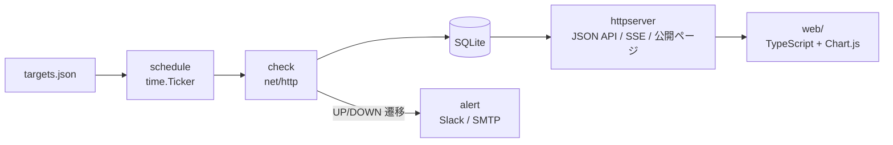
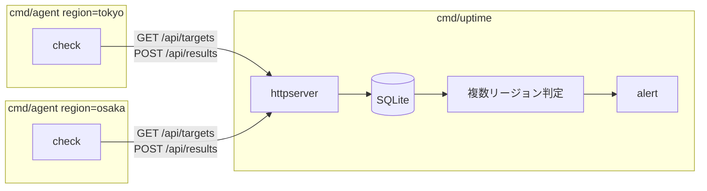
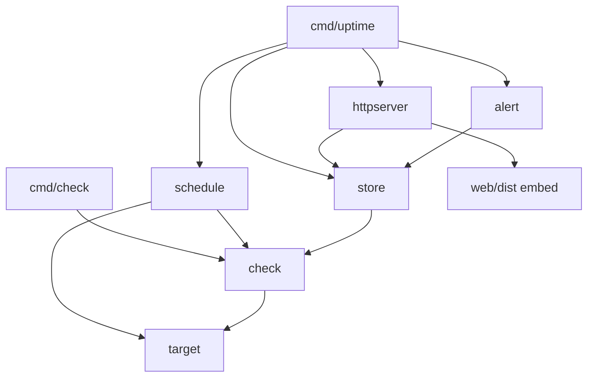

# システム概要

複数の URL を定期的に HTTP で疎通確認し、結果を保存して稼働率を表示し、停止時に通知するシステム。

## 入力

- 監視対象の設定ファイル (JSON)。対象ごとに名前・URL・チェック間隔。Step 9 以降はメソッド・ヘッダ・ボディ・期待キーワードも持つ
- 通知先の設定 (Slack webhook URL、SMTP 接続情報)。秘密情報は環境変数で渡す

## 出力

- 標準出力・ログ: チェックごとのステータスコード・応答時間・時刻
- SQLite: 全チェック結果、インシデント (DOWN の開始〜復旧)、証明書情報
- HTTP: 管理用ダッシュボード、認証なしの公開ステータスページ、JSON API、SSE、RSS
- 通知: UP→DOWN と DOWN→UP の遷移時。同一対象への連続通知はクールダウンで抑止

## 判定の定義

- **UP**: タイムアウト内にレスポンスを受け取り、ステータスコードが 2xx〜3xx
- **DOWN**: 接続失敗、タイムアウト、4xx 以上、または期待キーワード不一致
- **稼働率**: 期間内の UP 回数 ÷ チェック回数。24 時間 (Step 3) と 90 日 (Step 6)
- **証明書警告**: 有効期限まで 14 日以内 (Step 8)
- マルチリージョン (Step 7) では「2 リージョン以上で DOWN」のときだけ DOWN と判定して通知する

## 制約

- SQLite は書き込みプロセスを 1 つに限定する。Step 6 までは単一プロセス、Step 7 以降は中央サーバーだけが書く
- タイムスタンプは UTC の RFC3339 で保存する
- Web フレームワークは使わない。`net/http` 標準ライブラリ ([ADR 0001](../adr/0001-stdlib-net-http.md))

## 構成の変化

### Step 1〜6: 単一プロセス

`cmd/uptime` が schedule と httpserver を goroutine で同時に動かす。

### Step 7 以降: 中央 + リージョン別 agent

agent は中央から対象一覧を取得して結果を送る Pull 方式 ([ADR 0003](../adr/0003-single-process-until-multiregion.md))。

## パッケージの依存関係

`internal/` 配下は `target` と `check` が最下層。外部サービスに依存するのは `store` (SQLite)、`alert` (Slack/SMTP)、`httpserver` だけ。
